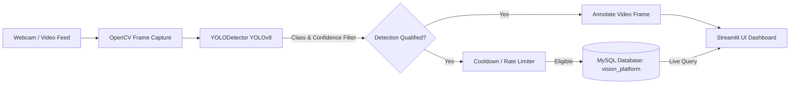

# 🎯 Real-Time Object Detection & Logging Platform

[](https://www.python.org/)
[](https://opencv.org/)
[](https://ultralytics.com/)
[](https://www.mysql.com/)
[](https://streamlit.io/)
[](https://opensource.org/licenses/MIT)

An enterprise-ready, modular computer vision platform that performs real-time object detection on live video feeds using **Ultralytics YOLOv8** and **OpenCV**, automatically extracts bounding box coordinates and classification metrics, logs structured detection events into a **MySQL database**, and visualizes live feeds and analytics through a sleek **Streamlit dashboard**.

Developed for **Assignment 5: Real-Time Object Detection & Logging Platform** (Community Engagement Program).

---

## 📑 Table of Contents
- [Key Features](#-key-features)
- [Architecture & Workflow](#-architecture--workflow)
- [Project Directory Structure](#-project-directory-structure)
- [Database Schema](#-database-schema)
- [Prerequisites](#-prerequisites)
- [Installation & Setup](#-installation--setup)
- [Running the Platform](#-running-the-platform)
- [Environment Configuration](#-environment-configuration)
- [Testing & Verification Checklist](#-testing--verification-checklist)
- [Demonstration & Article Links](#-demonstration--article-links)

---

## 🌟 Key Features

1. **Modular Architecture**: Strictly decoupled components (`detector.py`, `database.py`, `ui.py`, `main.py`) adhering to SOLID principles and software engineering best practices.
2. **YOLOv8 Real-Time Inference**: High-accuracy object detection powered by Ultralytics YOLOv8 nano model (`yolov8n.pt`) with bounding boxes, class labels, and confidence overlays.
3. **Dynamic Object Filtering**: Filter detections in real-time to monitor specific objects of interest (e.g., only `person`, `cell phone`, `laptop`, `bottle`) or monitor all 80 COCO classes.
4. **Tunable Confidence Threshold**: Dynamic sensitivity slider (10% to 100%) to eliminate false positives.
5. **Real-Time MySQL Event Logging**: Seamless event logging directly into a relational MySQL database (`vision_platform.detection_logs`) with timestamps, class names, confidence ratings, and bounding box dimensions.
6. **Smart Cooldown & Throttling**: Intelligent per-class debounce mechanism preventing database spam on high frame-rate video feeds (e.g. 30 FPS).
7. **Interactive Streamlit Dashboard**: Live video player, real-time analytics KPIs, live MySQL log inspection table, and detected class frequency charts.
8. **Dual Execution Modes**: Launch the modern **Streamlit Web Dashboard** or a high-performance **native OpenCV Desktop GUI**.
9. **Credential Security**: Strictly managed via `.env` with a `.env.example` template; sensitive credentials are never committed to version control.

---

## 🏗️ Architecture & Workflow



---

## 📂 Project Directory Structure

```plaintext
real-time-object-detection/
├── .env                     # Local environment variables (IGNORED in git)
├── .env.example             # Template environment variables for setup
├── .gitignore               # Ignores .env, weights (*.pt), cache, and virtualenvs
├── database_schema.sql      # MySQL schema creation script
├── database.py              # MySQL connector, table auto-creation, log insert & fetch
├── detector.py              # YOLOv8 model loading, inference, filtering, box overlays
├── main.py                  # Unified CLI entrypoint (Streamlit, OpenCV, or DB init)
├── requirements.txt         # Project dependencies
├── ui.py                    # Streamlit interactive web dashboard
├── DEMO_VIDEO_GUIDE.md      # Script and recording guide for the 1-2 min video demo
├── MEDIUM_ARTICLE.md        # Complete Medium publication draft
└── README.md                # Comprehensive project documentation
```

---

## 🗄️ Database Schema

The platform stores detection events in a relational schema inside the `vision_platform` database:

```sql
CREATE DATABASE IF NOT EXISTS `vision_platform`;
USE `vision_platform`;

CREATE TABLE IF NOT EXISTS `detection_logs` (
    `log_id` INT AUTO_INCREMENT PRIMARY KEY,
    `timestamp` DATETIME DEFAULT CURRENT_TIMESTAMP,
    `object_class` VARCHAR(100) NOT NULL,
    `confidence` FLOAT NOT NULL,
    `bbox_x` INT NOT NULL,
    `bbox_y` INT NOT NULL,
    `bbox_w` INT NOT NULL,
    `bbox_h` INT NOT NULL,
    INDEX `idx_timestamp` (`timestamp`),
    INDEX `idx_object_class` (`object_class`)
) ENGINE=InnoDB DEFAULT CHARSET=utf8mb4;
```

### Field Definitions:
- `log_id`: Unique auto-increment primary key for every event.
- `timestamp`: Timestamp when the object was detected and logged.
- `object_class`: Name of the detected object class (e.g., `person`, `cell phone`).
- `confidence`: Confidence score (float between `0.0` and `1.0`).
- `bbox_x`, `bbox_y`: Top-left coordinates of the bounding box.
- `bbox_w`, `bbox_h`: Width and height of the bounding box in pixels.

---

## 📋 Prerequisites

1. **Python 3.10+** (Tested on Python 3.10, 3.11, 3.12, 3.13)
2. **MySQL Server** (via **XAMPP**, **WAMP**, **MySQL Workbench**, or standalone MySQL service)
3. **Webcam** (built-in or USB camera) or sample video files

---

## 🚀 Installation & Setup

### 1. Clone the Repository
```bash
git clone https://github.com/your-username/Real-Time-Object-Detection.git
cd Real-Time-Object-Detection
```

### 2. Set Up a Virtual Environment (Recommended)
```bash
# On Windows
python -m venv venv
venv\Scripts\activate

# On macOS/Linux
python3 -m venv venv
source venv/bin/activate
```

### 3. Install Dependencies
```bash
pip install -r requirements.txt
```

### 4. Configure MySQL Database
1. Start your MySQL Server (e.g., open **XAMPP Control Panel** and click **Start** next to MySQL).
2. Copy `.env.example` to `.env`:
   ```bash
   cp .env.example .env
   ```
3. Edit `.env` to match your local credentials:
   ```env
   DB_HOST=localhost
   DB_USER=root
   DB_PASSWORD=
   DB_NAME=vision_platform
   DB_PORT=3306
   LOG_COOLDOWN_SECONDS=1.0
   DEFAULT_CONFIDENCE_THRESHOLD=0.50
   ```
4. Initialize the database and table schema automatically:
   ```bash
   python main.py --init
   ```
   *(Alternatively, import `database_schema.sql` directly into phpMyAdmin or MySQL Workbench).*

---

## 💻 Running the Platform

### Option A: Interactive Streamlit Dashboard (Recommended)
Launch the modern dashboard in your default browser:
```bash
streamlit run ui.py
```
*or using the unified entrypoint:*
```bash
python main.py
```
- Open your browser at `http://localhost:8501`.
- Choose your video source (**Webcam Live**, **Video Upload**, or **Image**).
- Filter objects (e.g., select `person` and `cell phone`).
- Adjust the confidence slider and rate limit.
- Check the box **"▶️ Start Live Webcam Stream"** to begin real-time detection and MySQL logging.

### Option B: Native OpenCV Window Mode
Run real-time detection directly in a desktop OpenCV window:
```bash
python main.py --cv
```
- Press `q` to exit the window.
- Press `s` to print database status in the console.

---

## 🔒 Environment Configuration & Security

> ⚠️ **Security Warning:** Never commit `.env` files or hardcoded database passwords to a public GitHub repository. This repository includes `.gitignore` by default to prevent credentials and model weights from being tracked.

---

## 🧪 Testing & Verification Checklist

- [x] Application launches without runtime syntax errors.
- [x] Webcam captures frames smoothly.
- [x] YOLOv8 draws bounding boxes and confidence badges accurately.
- [x] Class multiselect filter correctly isolates target objects.
- [x] Confidence threshold eliminates low-probability detections.
- [x] MySQL database and table auto-initialize cleanly.
- [x] Detection logs are committed to MySQL in real-time.
- [x] UI dashboard displays the latest MySQL log entries dynamically.
- [x] Zero hardcoded passwords; environment secured via `.env`.

---

## 🎬 Demonstration & Article Links

- 🐙 **GitHub Repository**: [https://github.com/nagaretejas077/obejct-detection-system](https://github.com/nagaretejas077/obejct-detection-system)
- 🎥 **Working Demo Video**: [YouTube / Google Drive Unlisted Link]
- 📝 **Medium Article**: [Published Medium Article URL]

---

## 👥 Author

- **Name**: Student Name
- **Course**: SE Div A/B/C
- **Program**: Community Engagement Program (CEP)
- **Assignment**: Assignment 5 — Real-Time Object Detection & Logging Platform
